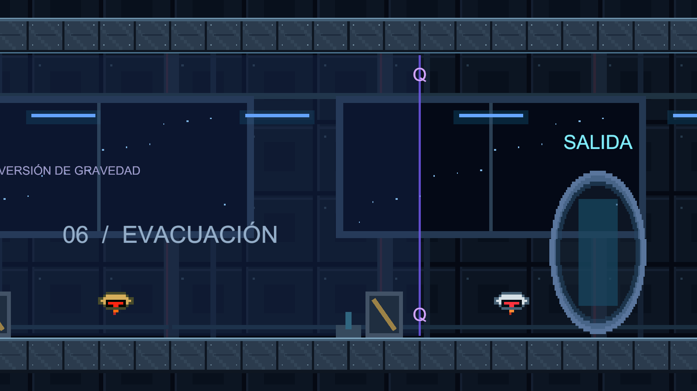

# Proyecto Umbral - Manual de usuario y edición

Versión 2.0 · 21 de octubre de 2026

## PROYECTO UMBRAL

Manual de usuario y edición

Versión 2.0 | Unity 6000.6.4f1 | Windows 64 bits

Stalyn Quispe · 21 de octubre de 2026

Hangar de evacuación. Captura del escenario renderizado en Unity, sin la interfaz de juego.

### Qué incluye esta versión

Seis sectores conectados, movimiento más ágil, gravedad invertida, proyectiles que destruyen enemigos y objetos, rescate de Mara y escape por el portal.

Este manual sirve para jugar y para ampliar el proyecto. Las páginas 2 a 4 explican la partida; las páginas 5 a 12 explican las herramientas, los parámetros y las comprobaciones en Unity.

> Proyecto: C:/Users/staly/Proyecto Primer Parcial. Conserva juntos el ejecutable y su carpeta de datos. Las herramientas de edición solo aparecen dentro del Editor de Unity.

## 1. Empezar a jugar

### Sin abrir Unity

1. Abre `Builds/Windows/Proyecto Umbral.exe` dentro de la carpeta del proyecto.
2. Pulsa Enter o el botón Iniciar misión. El juego comienza en Despertar.
3. Usa Esc para pausar, cambiar el volumen, reiniciar la misión o salir.

### Desde el Editor

Abre el proyecto en Unity Hub, entra en `Assets/Umbral/Scenes/Umbral.unity`, pulsa Play y después Enter. Haz clic en la vista Game si el teclado no responde.

| Tecla | Acción |
| --- | --- |
| A / D o flechas | Caminar a izquierda o derecha. |
| Shift + movimiento | Correr. |
| Espacio | Saltar. Mantenerlo produce un salto más alto; soltarlo antes lo acorta. |
| Q | Invertir la gravedad dentro de las zonas delimitadas en violeta. |
| J, pulsado o mantenido | Disparar hacia donde mira el personaje. Funciona en suelo, techo y aire. |
| E | Recoger módulos y usar palancas, relés, consola y portal. |
| R | Volver a la última baliza de control. |
| Esc | Pausar o continuar. |

> El progreso se conserva al reaparecer durante la misma partida. Reiniciar la misión o cerrar el juego no conserva un guardado permanente.

## 2. Objetivo y recorrido

Leo despierta después del accidente del reactor. Nexo guía el recorrido y Mara transmite mensajes desde su encierro. Recupera tres módulos, abre los accesos, libera a Mara y atraviesa el portal.

| Sector | Qué debes hacer |
| --- | --- |
| 01 · Despertar | Aprende a saltar y disparar. Invierte la gravedad para recoger el módulo 1 del techo con E. |
| 02 · Conductos | Cruza el foso por el techo, recoge el módulo 2 y activa la palanca del suelo con E. |
| 03 · Laboratorio criogénico | Supera el foso, destruye el Centinela y activa el relé de refrigeración con E. |
| 04 · Núcleo de seguridad | Cruza la zona superior. Destruye con J el generador rojo de tres impactos para abrir el acceso. |
| 05 · Reactor | Recoge el módulo 3 del techo. Instala los tres en la consola con E y libera a Mara. |
| 06 · Hangar de evacuación | Despeja cajas y enemigos mientras Mara se dirige al portal. Usa E junto a la salida. |

### Cómo leer la pantalla

La parte superior muestra el sector, el objetivo, los módulos recuperados y la dirección de la gravedad. El estado del pulso indica si está listo o recargando. Los enemigos reforzados muestran una barra de resistencia. Los avisos junto a Leo señalan cuándo puedes usar E.

> Si una compuerta sigue cerrada, revisa su requisito: módulo 1; módulo 2 más palanca; relé criogénico; generador de seguridad; o rescate de Mara. No necesitas un cuarto módulo.

## 3. Movimiento, combate y reinicio

### Movimiento más fluido

La marcha pasa de 3 a 4,8 unidades/s y la carrera de 5 a 7,2. La aceleración y el frenado reducen la sensación de retraso. El salto tiene una pequeña tolerancia al abandonar un borde y recuerda brevemente una pulsación hecha justo antes de aterrizar.

La cámara sigue el movimiento con suavizado. La física trabaja a 60 pasos por segundo y el cuerpo de Leo usa interpolación. Esto mejora la respuesta; no garantiza una tasa concreta de fotogramas en todos los equipos.

### El ataque sí destruye

J lanza un proyectil real. Al tocar un objetivo aplica daño y desaparece. Un Centinela normal resiste un impacto; uno dorado, dos; el generador rojo, tres. Al destruirse se apagan sus colisiones y aparecen fragmentos y una explosión. Las cajas también se pueden romper.

| Parámetro inicial | Valor |
| --- | --- |
| Recuperación entre disparos | 0,30 s. Mantener J repite el disparo. |
| Velocidad del proyectil | 18 unidades/s. |
| Alcance del proyectil | 7 unidades. Las paredes sólidas bloquean el disparo. |
| Daño por proyectil | 1 punto. |
| Recuperación de gravedad | 0,30 s entre inversiones. |

### Peligros y puntos de control

Los pinchos, un Centinela activo o salir de los límites del mapa provocan la reaparición en la última baliza. Los módulos recuperados, los circuitos activados y los objetivos destruidos conservan su estado dentro de la partida. La gravedad vuelve a apuntar hacia abajo y hay un breve periodo de protección.

## 4. Preparar una edición segura

### Organización del proyecto

| Carpeta dentro de Assets/Umbral | Contenido |
| --- | --- |
| Scenes | La escena Umbral con los seis sectores conectados. |
| Art | Los atlas PNG originales. |
| Generated | Sprites recortados, texturas, piezas de Tilemap y material de física. |
| Config | Balance.asset, Mundo.asset y definiciones de Leo y Mara. |
| Prefabs | Leo, Mara, Centinela, CentinelaReforzado, Caja y Generador. |
| Scripts | Controles, proyectiles, daño, compañeros, cámara e interfaz. |
| Editor | Generador de la escena, creación de salas e importador de personajes. |
| Tests | Pruebas de juego y de ampliación de salas. |

### Antes de modificar

1. Sal del modo Play. Los cambios hechos durante Play normalmente no se guardan al detenerlo.
2. Guarda la escena y crea una copia o un commit antes de cambiar el recorrido.
3. Trabaja sobre Umbral.unity. Conserva la escena original SampleScene como referencia.
4. Tras cambiar un objeto, guarda con Ctrl+S. Para reutilizarlo, conviértelo en Prefab o aplica sus cambios al Prefab correspondiente.

> Umbral > Generar o reconstruir prototipo vuelve a crear la escena y los recursos generados. Puede reemplazar salas y ajustes manuales del mundo. Para ampliar tu versión usa Crear sala adicional, no Reconstruir.

## 5. Añadir un escenario con la herramienta

1. Abre Umbral.unity y comprueba que no estés en Play.
2. En el menú superior elige Umbral > Crear sala adicional...
3. Escribe un nombre y una anchura de 20 a 80 unidades. Un ejemplo inicial es SECTOR EXPERIMENTAL, con 32 unidades.
4. Activa Incluir zona de gravedad si quieres practicar suelo y techo.
5. Deja Mover portal al nuevo final activado si la nueva sala formará parte del recorrido antes de escapar.
6. Pulsa Crear sala en la escena actual y guarda con Ctrl+S.

### Qué configura automáticamente

La herramienta crea una sala plana con suelo, techo, pared final, fondo, luces y baliza. Retira la pared que bloqueaba el acceso anterior, amplía Mundo.asset y añade el nombre del sector a su lista. Si eliges mover el portal, su punto de canalización para Mara se mueve junto con él.

### Qué debes diseñar después

Selecciona el Tilemap de la nueva sala para dibujar plataformas. Añade peligros y enemigos con distancias que permitan aterrizar. La sala inicial es una base conectada; no genera automáticamente un puzle completo ni nuevos objetivos narrativos.

> Si dejas el portal en su ubicación anterior, el jugador podrá completar la misión antes de explorar la sala añadida. Mantén tres módulos salvo que también amplíes la lógica del inventario.

### Prueba de conexión

Llega caminando desde el sector anterior, comprueba que desapareció la pared de acceso, activa la nueva baliza y prueba Q. Si moviste el portal, verifica que Leo y Mara puedan llegar a la nueva salida. El escenario básico asume suelo a Y=0 y techo a Y=8.

## 6. Dibujar plataformas y peligros

### Geometría y colisiones

1. Selecciona el Grid de la sala y su hijo Tilemap de geometría.
2. Abre Window > 2D > Tile Palette. Puedes arrastrar MetalSurfaceTile.asset, situado en Generated, a una paleta.
3. Selecciona ese Tilemap como destino y pinta sus plataformas. Cada celda equivale a una unidad del mundo.
4. Mantén la capa UmbralSolid, el componente TilemapCollider2D y el material SurfacePhysics para no introducir rozamiento lateral.

| Objeto | Configuración esencial |
| --- | --- |
| Suelo o plataforma | Layer UmbralSolid (6); collider sólido; Is Trigger desactivado. El Tile generado usa colisión Grid. |
| Fondo decorativo | Sin collider; orden de dibujo inferior al jugador y las plataformas. |
| Zona Q | UmbralProp: kind GravityZone; BoxCollider2D con Is Trigger. El volumen debe abarcar la ruta completa. |
| Pinchos o foso | UmbralProp: kind Hazard; collider con Is Trigger. Añade el dibujo del peligro por separado. |
| Baliza | UmbralProp: kind Checkpoint; collider con Is Trigger. Su Transform más Checkpoint Offset define la reaparición. |

### Evitar bloqueos

Coloca las balizas sobre terreno seguro, nunca dentro de un muro o un peligro. Prueba un salto real antes de fijar la distancia entre plataformas. Si cambias la altura general del nivel, ajusta también los volúmenes Q, el encuadre y los límites Min Safe Y / Max Safe Y de Mundo.asset.

> No basta con colocar una imagen del escenario: las superficies transitables necesitan sus propias colisiones. Evita escalar el objeto raíz de Leo para corregir el tamaño del dibujo; usa la definición del personaje.

## 7. Enemigos, circuitos y puertas

### Colocar un Centinela

1. Arrastra Centinela.prefab o CentinelaReforzado.prefab desde Prefabs a la escena.
2. Colócalo en una zona donde el proyectil frontal pueda alcanzarlo.
3. En UmbralDrone ajusta Left y Right: son coordenadas mundiales de los extremos de patrulla, no distancias relativas. Cambia también Speed.
4. En UmbralDamageable ajusta Max Health, Target Name y Explosion Color. Counts As Enemy controla si cuenta como enemigo destruido.

### Hacer una puerta que se abra con E

Duplica un relé existente o crea un objeto con UmbralProp, kind CircuitSwitch. Define Circuit como `laboratorio_b` y añade su dibujo. En la puerta usa UmbralProp, kind Door, el mismo Circuit y asigna su collider sólido al campo Barrier. Acércate al relé y pulsa E para activar la puerta. Message permite escribir el aviso al jugador.

### Hacer una puerta que se abra al disparar

Duplica Generador.prefab. En UmbralDamageable escribe `laboratorio_b` en Circuit On Destroy. Configura una puerta con Circuit=`laboratorio_b`. Cuando el generador pierda toda su resistencia, activa ese circuito. Usa nombres únicos para circuitos independientes.

| Elemento del recorrido actual | Referencia para localizarlo |
| --- | --- |
| Relé de refrigeración | X=101; circuito cryo; puerta X=107. |
| Generador rojo | X=139,5; circuito security; puerta X=145. |
| Módulos | Índices 0, 1 y 2; X=25, X=49 y X=158. |
| Consola / Mara / portal | X=174 / X=179,5 / X=214. |

> Para que un proyectil detecte un objeto, su collider debe estar en UmbralSolid (6) o UmbralDrone (7). Para que reciba daño necesita UmbralDamageable; el nombre del objeto o su Tag no bastan.

## 8. Importar un personaje nuevo

### Preparar el atlas

Utiliza PNG con transparencia y veinte cuadros organizados en cuatro columnas y cinco filas. De arriba a abajo: Idle, Walk, Run, Jump y Attack. Cada fila se lee de izquierda a derecha. La vista base mira hacia la derecha; el controlador refleja el dibujo para mirar a la izquierda.

1. Copia el PNG dentro de Assets, por ejemplo en Assets/Umbral/Art/Custom.
2. Abre Umbral > Importar personaje desde atlas 4x5...
3. Arrastra el PNG al campo Atlas PNG. Escribe un nombre único y el valor Pixels Per Unit adecuado.
4. Pulsa Crear definición de personaje. Se generarán veinte sprites en Generated y una definición Custom_Nombre.asset en Config.
5. Revisa Frames en la definición: posiciones 0-3 Idle, 4-7 Walk, 8-11 Run, 12-15 Jump y 16-19 Attack.
6. Ajusta Visual Scale y Collider Size. Asigna Pulse Frames si dispones de cuatro cuadros de energía propios.

| Material de partida | PPU inicial orientativo |
| --- | --- |
| Atlas originales de Leo y Mara | 132: los dibujos tienen alrededor de 200 píxeles de altura. |
| Celdas de 64x64; figura de 48 px | 32: una figura de 48 px mide aproximadamente 1,5 unidades. |
| Tiles de 32x32 | 32: una pieza ocupa una celda de una unidad. |

> El importador actual admite el esquema 4x5. Un atlas de ocho cuadros por acción requiere cambiar el controlador y el orden de Frames; no basta con aumentar el tamaño del PNG. Comprueba bordes, transparencia y alineación antes de usar el personaje.

## 9. Usar y ajustar los personajes

### Cambiar el aspecto del protagonista

1. Selecciona Leo · Protagonista en la jerarquía.
2. En UmbralPlayer arrastra la nueva definición al campo Character. Mantén Balance.asset en Settings.
3. En el menú del componente ejecuta Aplicar definición de personaje para previsualizar el dibujo y la cápsula. También se aplica automáticamente al iniciar la partida.
4. Prueba caminar, correr, saltar, invertir gravedad y disparar mirando a ambos lados. Guarda y, si quieres reutilizarlo, crea un Prefab nuevo.

### Sustituir el objeto completo

Si instancias un nuevo Prefab en lugar de cambiar Character, deja un solo UmbralPlayer activo. Asigna ese nuevo objeto a Player en UMBRAL · Control de misión y su Transform a Target en Main Camera / UmbralCamera. El nuevo objeto necesita Rigidbody2D, CapsuleCollider2D y una referencia Visual a su SpriteRenderer hijo.

### Cambiar Mara

Selecciona Mara · Aliada y asigna la nueva definición al campo Character de UmbralCompanion. Mantén Is Mara activado y Visual asignado. Mara sigue siendo una aliada: cambiar sus sprites no crea un segundo jugador ni cambia los diálogos de la historia.

| Campo de definición | Qué modifica |
| --- | --- |
| Frames | Los veinte cuadros usados en la animación. |
| Visual Scale | Escala del dibujo, manteniendo separado el cuerpo físico de Leo. |
| Collider Size | Tamaño de la cápsula del protagonista en unidades del mundo. |
| Pulse Frames | Cuatro imágenes del proyectil; si queda vacío se usa el pulso de la misión. |
| Energy Color | Color del destello al disparar. |
| Display Name | Identificación del recurso; no sustituye automáticamente los textos narrativos. |

## 10. Ajustar velocidad, cámara y compilación

### Balance.asset: editar desde el Inspector

Selecciona Assets/Umbral/Config/Balance.asset. Cambia los valores fuera de Play para conservarlos. Las unidades son distancias del mundo y segundos.

| Campo | Valor inicial / efecto |
| --- | --- |
| Walk Speed / Run Speed | 4,8 / 7,2: velocidad de marcha y carrera. |
| Ground Acceleration / Braking | 70 / 85: rapidez al acelerar y frenar. |
| Air Acceleration | 45: control horizontal durante el salto. |
| Jump Speed / Gravity Scale | 8,4 / 2,1: impulso y gravedad aplicada al personaje. |
| Jump Buffer / Coyote Time | 0,16 / 0,12 s: tolerancia antes de aterrizar y después de dejar un borde. |
| Jump Release Multiplier | 0,55: cuánto se reduce la subida al soltar Espacio. |
| Max Fall Speed | 16: límite de velocidad vertical. |
| Flip Cooldown / Attack Cooldown | 0,30 / 0,30 s. |
| Projectile Speed / Range / Damage | 18 / 7 / 1: rapidez, alcance y daño del disparo. |

### Cámara y mundo

En Main Camera / UmbralCamera, Smooth Time empieza en 0,14 s y Look Ahead en 2,6 unidades. Un suavizado muy alto aumenta la sensación de retraso. Mundo.asset contiene Min X, Max X, Camera Y, límites verticales y la lista ordenada de sectores con sus Start X. La herramienta de salas actualiza esa lista y Max X.

### Crear un ejecutable actualizado

Guarda la escena y usa Umbral > Compilar Windows. El resultado se escribe en Builds/Windows/Proyecto Umbral.exe. Una edición del proyecto no modifica por sí sola el ejecutable anterior. Para compartir, entrega toda la carpeta Windows, incluida Proyecto Umbral_Data y las bibliotecas.

## 11. Comprobar y resolver problemas

| Síntoma | Qué revisar |
| --- | --- |
| No se mueve | Estar dentro de la misión, sin pausa, con foco en Game; Player y Camera Target asignados. |
| Q no responde | Leo debe estar dentro de un collider GravityZone. Comprueba Is Trigger y la recuperación entre cambios. |
| J no causa daño | Distancia y orientación; pared intermedia; collider del objetivo en capa 6 o 7 y componente UmbralDamageable. |
| Enemigo vuelve a su posición anterior | Left y Right siguen apuntando a las coordenadas mundiales del Prefab original. |
| Atraviesa el suelo | TilemapCollider2D presente, capa UmbralSolid, Is Trigger desactivado y tiles con colisión. |
| Dibujo enorme o desalineado | PPU, tamaño de celda, pivotes, Visual Scale y orden de Frames. Mantén constante la escala entre cuadros. |
| Nueva sala inaccesible | Retirar pared antigua, conservar suelo continuo, ampliar Max X y guardar Umbral.unity. |
| No termina en la nueva salida | Mover el objeto raíz Portal de escape con su punto hijo de canalización; revisar que existan tres módulos y consola. |

### Lista de revisión antes de entregar

1. Recorrer los seis sectores desde el inicio. 2. Disparar a izquierda y derecha y en el aire. 3. Verificar paredes y enemigos reforzados. 4. Reaparecer conservando módulos. 5. Abrir cada puerta y rescatar a Mara. 6. Alcanzar el portal. 7. Revisar la Console sin errores. 8. Volver a compilar Windows.

### Pruebas incluidas

En Window > General > Test Runner, PlayMode contiene pruebas de recorrido completo mediante teclado, física, perfiles, interacciones y proyectiles. EditMode comprueba que una sala nueva abra el acceso anterior y actualice cámara y portal. Las pruebas automáticas no sustituyen la revisión visual ni las pruebas de dificultad con personas.

> El arte es el del prototipo y sigue siendo ajustable. No hay guardado entre sesiones, modo cooperativo ni cambio de personaje durante la partida. El control es por teclado.
